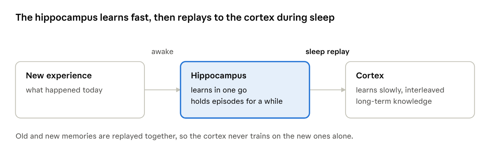
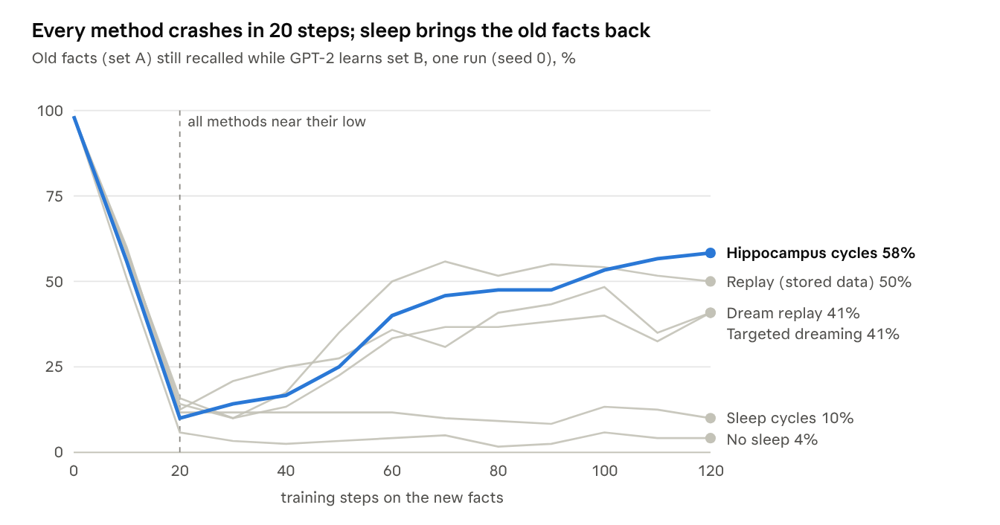
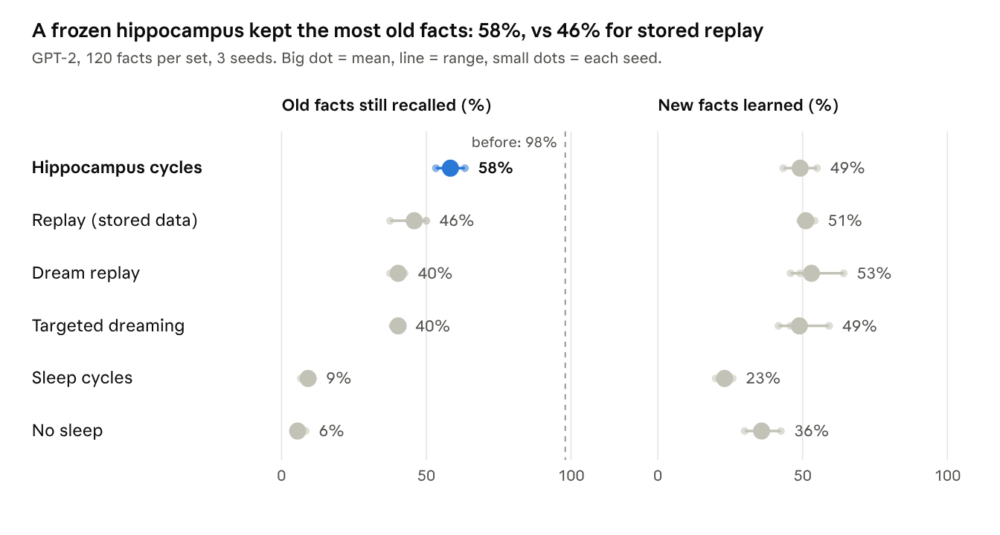

*What the brain's memory replay teaches us about catastrophic forgetting*

I taught GPT-2 120 made-up facts, then 120 more, and it lost almost all of the first set: recall fell from 98% to 6%. Then I let it "sleep", replaying its own dreams of the old facts while it learned the new ones. It kept 40%. Giving it a separate, frozen memory to dream from, like a hippocampus, kept 58%, the best result in every run.

This post is about why neural networks forget, how the sleeping brain avoids it, and what happened when I tried the brain's trick on a real language model. The code is on [GitHub](https://github.com/woletee/can-ai-learn-to-sleep) if you want to rerun it.

## Why does AI forget everything it just learned?

A neural network stores everything it knows in one shared set of weights. When you train it on something new, every weight is free to move toward the new task, and nothing protects the weights the old task relied on. So the new knowledge is written over the old. Researchers call this catastrophic forgetting; McCloskey and Cohen first described it in 1989.

It is not the same as a model that does badly on unfamiliar data. That is domain shift: the model never learned the new data in the first place. Forgetting means the model *did* know something, learned something else, and lost the first thing.

You can watch it happen in a few minutes on a laptop. In my experiment GPT-2 learned 120 invented facts ("The capital of Guthe is Brira") until it recalled 98% of them. Then it trained on 120 different invented facts. After 120 training steps it recalled only 4–8% of the first set.

## Wait, doesn't ChatGPT remember me?

It seems to, but it isn't learning. When a chatbot remembers what you said yesterday, it saved a note about you and pastes that note back into the prompt the next time you talk. The model's weights never change. It is like a person who can't form new memories reading their own diary every morning.

That trick works because nothing is ever trained. The forgetting problem appears the moment you actually update the weights: fine-tuning a model on your company's documents, teaching it a new language, or adapting a medical model to a new scanner. Studies of 1–7B language models during continual fine-tuning found they forget general knowledge, and the larger models in the study forgot more ([Luo et al., 2023](https://arxiv.org/abs/2308.08747)).

So the real question is: can a model learn new things *in its weights* without losing the old ones?

## How does the brain avoid this?

The brain splits the job between two systems. The hippocampus learns new experiences fast, sometimes after one exposure. The cortex learns slowly and holds what we know for years. This is the complementary learning systems theory ([McClelland, McNaughton and O'Reilly, 1995](https://doi.org/10.1037/0033-295X.102.3.419)).

The link between them is sleep. In 1994 Wilson and McNaughton recorded the same place cells that fired while rats ran a maze firing again, in the same order, while the rats slept ([Wilson and McNaughton, 1994](https://doi.org/10.1126/science.8036517)). The brain was replaying the day.

Replay solves the forgetting problem. The cortex never learns the new memories alone: during sleep it sees them mixed with replays of older ones, so new learning doesn't overwrite old knowledge. And the brain doesn't keep a perfect recording to replay. It regenerates memories, more like dreaming than playing back a video.

## What has AI borrowed from sleep so far?

AI researchers have copied replay in three forms. Each one keeps something from the old task and mixes it into training on the new one.

| Method | What gets replayed | Catch |
| --- | --- | --- |
| Experience replay | Stored real examples from old tasks | You must keep the old data, which may be private or too large |
| Generative replay ("dreaming") | Fake examples the model generates of old tasks | Only as good as the dreams |
| Brain-inspired replay | Generated internal features, not raw inputs | Tested mostly on image tasks |

The most complete version is [van de Ven, Siegelmann and Tolias (2020)](https://doi.org/10.1038/s41467-020-17866-2). They added brain-like features to generative replay: replaying internal representations instead of pictures, and letting the network gate its own context. It scaled to harder image benchmarks where earlier replay failed. They also found that replay did not need to be high quality to help.

Language models have tried it too. [LAMOL (Sun et al., 2020)](https://arxiv.org/abs/1909.03329) had GPT-2 generate pseudo-examples of earlier tasks and train on them alongside new ones. [Self-Synthesized Rehearsal (Huang et al., 2024)](https://arxiv.org/abs/2403.01244) does the same with a large language model writing its own rehearsal data. Both are a kind of dreaming.

## Does it work on a real language model?

Yes. On GPT-2, every form of sleep that replayed real memories kept 6–10 times more old facts than no sleep, and a separate frozen memory worked best.

**The setup.** GPT-2 (124M parameters) first learned 120 invented facts (set A) until it recalled 98% of them. Then it learned 120 new invented facts (set B). Every condition got exactly 120 training steps on B; the sleeping ones spent a quarter of each batch on replay instead of new facts. I compared six ways to learn B:

1. **No sleep:** train on B only.
2. **Replay:** mix in stored copies of the real A facts.
3. **Dream replay:** before learning B, the model writes 30 "dreams" by completing the prompt "Fact: The…". Train on those. No stored data.
4. **Targeted dreaming:** dream 4× more, keep the dreams the model is least sure about.
5. **Sleep cycles:** dream again every 20 steps (each "night") from the model as it is now.
6. **Hippocampus cycles:** dream every night, but from a frozen copy of the model saved before it started on B.

I ran everything with three random seeds: different invented facts, training order and dreams each time.

Here is what happens during training in one run. Every method loses most of the old facts in the first 20 steps. The difference is what comes back afterwards: with replay, the old facts return while the new ones are learned; with no sleep, they never do.

Averaged over all three seeds, the final scores look like this:

**Dreams almost match the real thing.** Dream replay kept 40% of old facts against 46% for stored replay, without keeping any old data. 93% of its dreams were exact real memories.

**Targeting the weakest memories didn't help.** It tied plain dreaming. Picking uncertain dreams also picked more false ones: only 77% were real.

**Dreaming from a mind that is already forgetting fails.** In sleep cycles, by the second night 0–3% of fresh dreams were real facts. The model was dreaming made-up facts and training on them, and it ended up worse than having no sleep at learning B.

**A stable, separate memory wins.** The frozen hippocampus kept 58% of old facts, the best in all three seeds; its worst seed beat stored replay's best. Every night 87–97% of its dreams were real. It also learned new facts about as well as stored replay (49% vs 51%).

## Where does the sleep analogy break?

The experiment borrows one idea from sleep, replay, and leaves most of the biology behind.

- **Sleep only protected what it replayed.** GPT-2's perplexity on ordinary English rose from 27 to about 1,500 after learning set A, and to 6,300–10,300 after set B, with or without sleep. The dreams were about invented facts, so nothing protected its general English. The brain replays far more broadly.
- **Our "nights" are not nights.** A night here is a training step where a quarter of the batch is dreams. Real sleep has stages (slow-wave and REM) that seem to do different jobs; I didn't model any of them.
- **The hippocampus is a frozen copy, not a learner.** Mine never changes. A real hippocampus keeps learning, and over weeks hands memories to the cortex until it no longer needs them.
- **Recall was graded on exact words.** A fact counts only if the model writes the exact first word of the answer. That is strict, and it says nothing about meaning or reasoning.
- **It is small.** One 124M model, 120 facts per set, three seeds. That is enough to say the result is consistent, not enough to say it holds for large models.
{.bullets-warn}

The interesting gap is the third one. Sleep cycles failed because the model dreamed from a memory that was being overwritten. The brain avoids that by keeping the two stores apart, which is exactly what the frozen copy did.

## So, should AI sleep?

If "sleep" means replaying old memories while learning new ones, from a memory that the new learning can't touch, then yes: on GPT-2 it was the best method I tried. It kept 58% of old facts against 6% with no sleep, and it needed no stored data.

Three lessons carry over beyond this toy setup:

1. **Dream quality decides how much sleep helps.** Dreams that were 93% real worked almost as well as real data; dreams that were 0–3% real barely beat no sleep on old facts and hurt learning new ones.
2. **Don't dream from the mind you are changing.** Once the model starts forgetting, its dreams turn into made-up facts, and training on them speeds up the damage.
3. **Keep a stable second memory.** A frozen snapshot is cheap: one copy of the weights, used only to dream.

The second lesson contrasts with the image-model results of van de Ven and colleagues, who found low-quality replay was often enough. For facts in a language model, a wrong dream is not just blurry; it is a false memory.

**What I want to try next:**

- Repeat the run on a 0.5–1.5B model with LoRA (Qwen2.5-0.5B, DeepSeek-R1-Distill-Qwen-1.5B) on a free Colab GPU.
- Replay general English as well as facts, to see if sleep can protect the model's language too.
- Let the hippocampus slowly catch up with the cortex, instead of staying frozen forever.
{.bullets-idea}

## Method notes and references

**Run it yourself.** All the code, notebooks and results are on GitHub: [woletee/can-ai-learn-to-sleep](https://github.com/woletee/can-ai-learn-to-sleep). It is one Python script (`sleep_experiment.py`) plus a Colab notebook for larger Qwen models. Each GPT-2 seed takes about 50 minutes on a laptop CPU.

| Setting | Value |
| --- | --- |
| Model | GPT-2, 124M, full fine-tuning |
| Facts | 120 per set, invented words, 3 sentence templates |
| Learning set A | 30 epochs, learning rate 5e-5, 10 warm-up steps, batch 16 |
| Learning set B | 120 steps for every condition |
| Replay share | 25% of each batch |
| Dreams | 30 per night, sampled from "Fact:" prompts |
| Nights (cycles) | every 20 steps |
| Recall test | greedy decoding, exact match on the answer's first word |
| Seeds | 0, 1, 2 |

**References**

- McCloskey and Cohen (1989), Catastrophic interference in connectionist networks. *Psychology of Learning and Motivation* 24.
- [McClelland, McNaughton and O'Reilly (1995)](https://doi.org/10.1037/0033-295X.102.3.419), Why there are complementary learning systems in the hippocampus and neocortex.
- [Wilson and McNaughton (1994)](https://doi.org/10.1126/science.8036517), Reactivation of hippocampal ensemble memories during sleep.
- [van de Ven, Siegelmann and Tolias (2020)](https://doi.org/10.1038/s41467-020-17866-2), Brain-inspired replay for continual learning with artificial neural networks.
- [Sun, Ho and Lee (2020)](https://arxiv.org/abs/1909.03329), LAMOL: language modeling for lifelong language learning.
- [Huang et al. (2024)](https://arxiv.org/abs/2403.01244), Mitigating catastrophic forgetting in large language models with self-synthesized rehearsal.
- [Luo et al. (2023)](https://arxiv.org/abs/2308.08747), An empirical study of catastrophic forgetting in large language models during continual fine-tuning.
{.bullets-clip}
